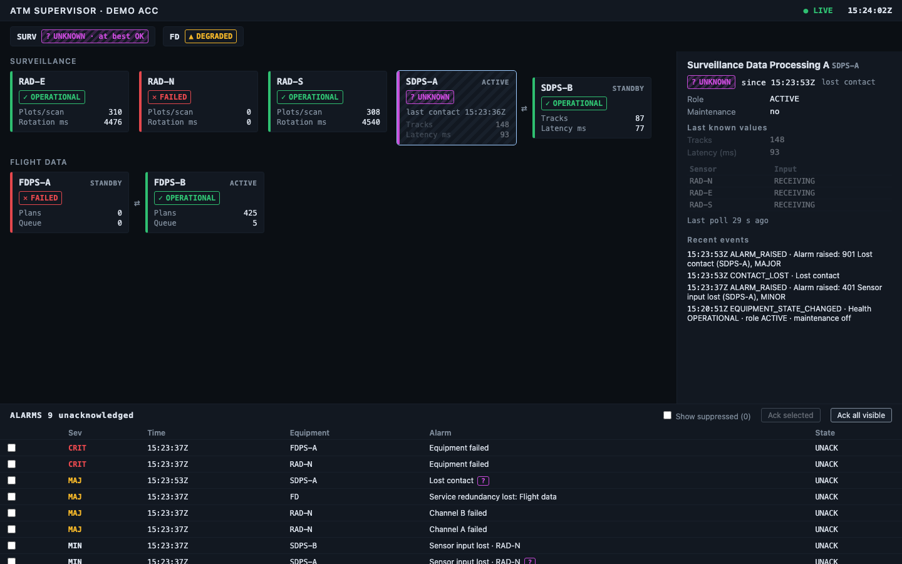
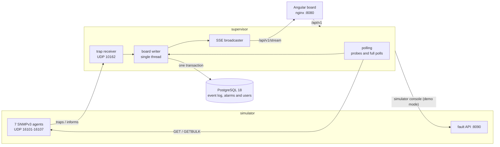
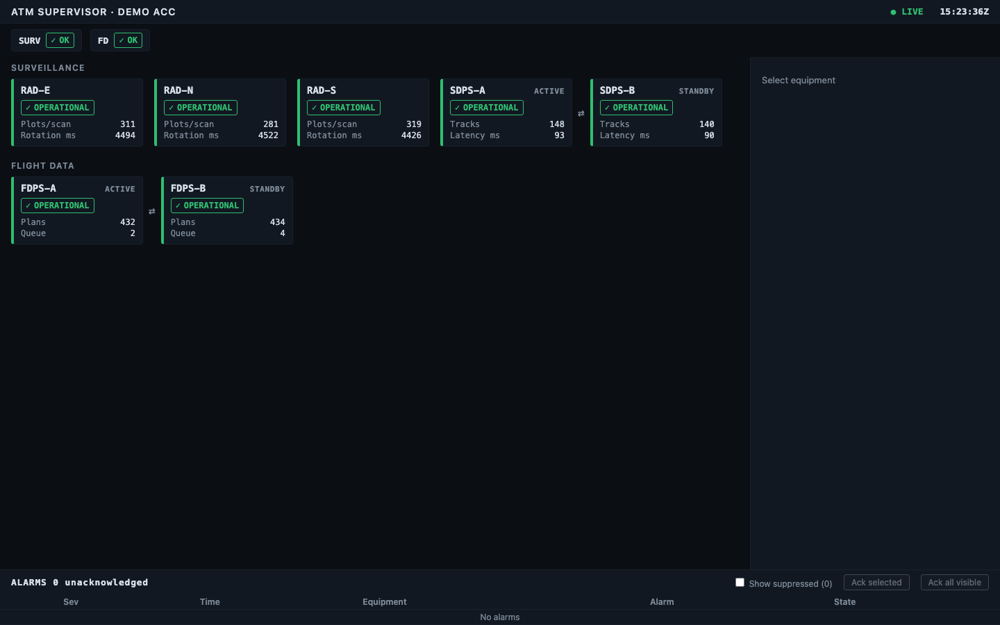

# ATM Supervisor

ATM Supervisor is an open-source technical supervision tool for air traffic management (ATM)
systems. It polls simulated surveillance and flight data equipment over SNMPv3, receives their traps
and informs, reconciles their alarm tables, derives the state of the operational services they
support, and shows it all on a live operator board. It is built for the System Controller's view of
a centre: what has failed, what is only unconfirmed, and what that means for the service controllers
receive. The centre it supervises is fictional: **Demo ACC**.

> **Non-operational prototype.** ATM Supervisor and Demo ACC are fictional and not affiliated with
> any air navigation service provider. Nothing here is certified or fit for operational use.



*RAD-N has failed, SDPS-A has stopped answering, and FDPS-A has failed so FDPS-B took over. SDPS-A
is `UNKNOWN`, not green, with its last known values greyed. Surveillance is `UNKNOWN · at best OK`
because the answer depends on SDPS-A, and its open alarms are marked unconfirmed (`?`).*

## Engineering highlights

- **`UNKNOWN` is never treated as healthy.** A device the supervisor cannot confirm is `UNKNOWN` with
  a reason. Services are evaluated twice, with unknown equipment assumed available and unavailable,
  and a known failure is never hidden behind "unknown".
- **Polling is the source of truth; traps only speed it up.** Every trap triggers a re-poll, and every
  successful full poll reconciles the device's alarm table, so a lost trap cannot hide an alarm.
- **Stale results are rejected.** Each device has a status generation and a contact generation, and a
  poll or probe result started under an older generation is discarded.
- **Probes do not depend on the circuit breaker.** Lightweight `sysUpTime` probes alone decide
  contact. The per-device breaker guards only the full polls.
- **Full polls are single-flight per device.** Traps that arrive during a poll coalesce into exactly
  one follow-up poll.
- **One writer, one transaction.** A single board writer decides each input, commits its events and
  alarm rows in one PostgreSQL transaction, and applies only what was committed.
- **A slow browser cannot stall supervision.** The writer never does network I/O. Each SSE client
  has a bounded queue, and a client that overflows it is disconnected and resumes from the server's
  buffer of recent events, never silently skipped.
- **The impact analysis is the board's own rules.** The Impact screen reruns the same service evaluator with
  chosen units out of service, so a single point of failure or a planned maintenance can never be judged by a
  second model that disagrees with the board. Its verdicts are NO SERVICE IMPACT, REDUCED MARGIN and SERVICE
  LOSS, and nothing is blocked. With units in `UNKNOWN` state, a verdict is the worst over every possible state of
  those units, marked unconfirmed when the states disagree. It is exact up to 10 such units, and beyond that a
  conservative bound that can only overstate.
- **Telemetry is sampled, never invented.** Values are stored every 30 s while polls succeed, and a
  missed poll produces no sample.

Each of these is tied to its code and tests in the [hazard log](docs/safety/hazard-log.md).

## Status

The current release is **v0.1.1**: three device types end to end, hardened after external review.
The [design](docs/design/2026-11-13-atm-supervisor-design.md) describes the full target, and the
[phases](docs/design/2026-11-13-atm-supervisor-design.md#13-phases) say what comes when.

| Capability | Status |
|---|---|
| RADAR, SDPS and FDPS supervision: 7 devices, A/B pairs with automatic switchover | Implemented |
| SURV (surveillance) and FD (flight data) service derivation | Implemented |
| SNMPv3 authPriv polling, probes and per-device circuit breakers | Implemented |
| SNMPv3 traps and informs | Implemented |
| Alarm-table reconciliation on every full poll | Implemented |
| Alarms with acknowledgement, escalation and maintenance suppression | Implemented |
| Event log and telemetry sampled every 30 s, in PostgreSQL | Implemented |
| Live Angular board over SSE, with resume after a lost connection | Implemented |
| Fault injection through the simulator's REST API | Demo-only |
| SNMP `SET` from the command line, straight to an agent | Demo-only: bypasses the supervisor |
| ADS-B, voice, radio, recorder and network switch (IF-MIB, SNMPv2c) supervision | Planned (v0.2) |
| VOICE, REC and NET services | Planned (v0.2) |
| Scripted fault scenarios | Planned (v0.2) |
| Control commands with interlocks, a mandatory reason and outcome tracking | Planned (v0.3) |
| Sign-in, registration and roles (VIEWER, SUPERVISOR, ADMIN) | Implemented |
| Impact analysis: single points of failure and a what-if maintenance planner, with a preview on Maintenance on | Implemented |
| Replay, snapshots, export and retention | Planned (v0.3) |
| Prometheus, `snmp_exporter` and Grafana | Planned (v1.0); Actuator metrics exist today |
| Browser end-to-end tests | Planned (v1.0) |

### Known limitations

- **Service rules use availability only.** A `DEGRADED` unit counts as available, so a degraded active
  unit does not yet degrade its service.
- **Database outage.** The board keeps its last persisted state and the tiles turn stale, but there is
  no explicit storage-down signal yet. The writer queue and the number of SSE clients are not bounded yet.
- **One supervisor instance.** While it is down, nothing is supervised; on restart every device is
  `UNKNOWN` until its first poll.
- **One slow recovery path.** If contact returns while a half-open trial poll is still running, the
  device can stay `UNKNOWN` for up to about 30 s.

## Architecture



| Module | Purpose |
|---|---|
| `mib/` | `DEMO-ATM-TECHSUP-MIB.txt`, OID constants and `lint.sh` (smilint); see the [MIB guide](docs/mib.md) |
| `inventory/` | Device inventory model, loaded from `config/inventory.yml` |
| `simulator/` | 7 hand-written SNMPv3 agents on SNMP4J core, and a fault REST API |
| `supervisor/` | Polling, traps, alarms, board, REST and SSE, sign-in and roles, PostgreSQL persistence with a Liquibase changelog (Spring Modulith modules) |
| `ui/` | Angular 22 board |
| `deploy/` | `docker-compose.yml` and the nginx config |

## Code tour

Start here to see how the invariants above are implemented:

| File | Why it matters |
|---|---|
| [`PollScheduler`](supervisor/src/main/java/io/github/selvitopu/atmsup/supervisor/polling/PollScheduler.java) | Runs probes outside the breaker and full polls through it, keeps full polls single-flight, and verifies a device at once when contact returns. |
| [`DeviceBreakers`](supervisor/src/main/java/io/github/selvitopu/atmsup/supervisor/polling/DeviceBreakers.java) | The per-device Resilience4j breakers that guard full polls: a window of 5 calls that opens at 50 % failures. |
| [`SecurityConfig`](supervisor/src/main/java/io/github/selvitopu/atmsup/supervisor/security/SecurityConfig.java) | Session sign-in with a CSRF cookie for the single-page UI, problem-detail refusals, and the role hierarchy ADMIN > SUPERVISOR > VIEWER. |
| [`BoardWriter`](supervisor/src/main/java/io/github/selvitopu/atmsup/supervisor/board/BoardWriter.java) | The only writer of the board: decide, commit in one transaction, apply what was committed, then publish. |
| [`BoardDecider`](supervisor/src/main/java/io/github/selvitopu/atmsup/supervisor/board/BoardDecider.java) | Turns each input into events, discards stale results by generation, and samples telemetry. |
| [`StatusDeriver`](supervisor/src/main/java/io/github/selvitopu/atmsup/supervisor/board/StatusDeriver.java) | Derives health, contact and the `UNKNOWN` reasons from probes and full polls. |
| [`ServiceEvaluator`](supervisor/src/main/java/io/github/selvitopu/atmsup/supervisor/board/ServiceEvaluator.java) | Runs every service rule in two passes so unknown equipment can only make a service `UNKNOWN`, never `OK`. |
| [`AlarmEngine`](supervisor/src/main/java/io/github/selvitopu/atmsup/supervisor/alarms/AlarmEngine.java) | The alarm lifecycle, and the reconciliation of open alarms against a device's alarm table. |
| [`SseBroadcaster`](supervisor/src/main/java/io/github/selvitopu/atmsup/supervisor/api/SseBroadcaster.java) | Fans committed events out to browsers through bounded per-client queues, with resume from a ring buffer. |
| [`DeviceResponder`](simulator/src/main/java/io/github/selvitopu/atmsup/simulator/agent/DeviceResponder.java) | The hand-written SNMP agent: GET, GETNEXT, GETBULK and SET with the correct SNMP error statuses. |
| [`SupervisorEndToEndIT`](supervisor/src/test/java/io/github/selvitopu/atmsup/supervisor/SupervisorEndToEndIT.java) | The whole supervisor against real agents over UDP and PostgreSQL in Testcontainers, including recovery from lost traps. |

## How it is tested

- **Unit tests** cover the service rules, status derivation, the alarm lifecycle and reconciliation,
  the board writer pipeline, the poll scheduler and SSE backpressure.
- **Real SNMP over UDP.** Integration tests start the simulator's agents in-process on free ports. The
  supervisor's SNMP4J client polls them, walks their tables, receives their traps and informs, and
  sees wrong passwords and timeouts; the simulator's own tests cover SETs and their error statuses.
- **PostgreSQL through Testcontainers** for the event log, alarm uniqueness, the Liquibase seed data and the end-to-end test.
- **Module boundaries** are verified with Spring Modulith.
- **Angular** unit tests with Vitest, and the production build.
- **The MIB** is linted with `smilint`, and the Java OID constants are checked against it.
- **Compose healthchecks** gate startup, and the preflight script waits until the board is `READY`.

CI (`.github/workflows/ci.yml`) runs the backend build with all tests, the frontend tests and build,
and the MIB lint.

## Quickstart

Requires Docker with Compose v2, bash, curl, python3 and lsof (the preflight script uses all of them). On
macOS, python3 comes with the Command Line Tools (`xcode-select --install`). The first time, while online,
build the images:

```sh
scripts/demo-preflight.sh --build
```

The script builds the images, starts the stack, resets the simulator and waits until the board is
`READY`. From then on the demo runs offline. Start it again from the repository root with:

```sh
docker compose up -d --wait
```

`--wait` returns once all four services are healthy. Open <http://localhost:8080>. The root
`compose.yaml` includes `deploy/docker-compose.yml`, so `docker compose -f deploy/docker-compose.yml up -d --wait`
is equivalent. `scripts/demo-preflight.sh --fresh` first removes the demo volumes (alarm history), and
`--help` lists the options. The scripted tour is in [docs/demo-v0.1.md](docs/demo-v0.1.md).



Sign in as `supervisor1` and open **Simulator** from the header: it lists the simulated devices with
their state and faults. Click **Fail** in the `RAD-N` row and watch the board, then **Recover** to undo it.
Faults add up until **Recover** clears every fault of the device, and each row offers only the faults
its type supports:

| Fault | RADAR | SDPS | FDPS | Effect |
|---|:-:|:-:|:-:|---|
| `FAIL` | yes | yes | yes | The device fails (a radar loses both channels). |
| `DEGRADE` | yes | yes | yes | The device is degraded. |
| `RECOVER` | yes | yes | yes | Clears every fault of the device. |
| `CHANNEL_A_FAIL`, `CHANNEL_B_FAIL` | yes | | | One radar channel fails; the radar is degraded. |
| `SENSOR_LOST` | | yes | | One sensor input is lost. Needs a `target`. |
| `UNREACHABLE` | yes | yes | yes | The agent stops answering SNMP requests. |
| `DROP_TRAPS` | yes | yes | yes | The agent stops sending traps and informs. |

**Sensor lost** names the sensor, one of the radars `RAD-N`, `RAD-E` or `RAD-S`, picked beside the
button (a second one replaces the first). **Reset all** clears every fault of every device after a
confirmation. The Simulator screen exists only in demo mode.

Equipment commands are on the board: select a tile, and supervisors see **Maintenance on/off**,
**Restart** (in maintenance only) and **Make active** (for a standby unit) in its panel. Each asks for
a confirmation that names the unit, the supervisor sends it as an SNMP `SET`, and the event log records
who sent it and what came of it; the confirmation for **Maintenance on** also previews the impact on the
services. **Alarm history** searches every alarm, **Impact** shows which single failure would cost a service
and what a planned maintenance leaves, and administrators manage accounts on **Users**.

Stop the stack with `docker compose -f deploy/docker-compose.yml down` (add `-v` to drop the data volumes).

### Signing in

The board needs a signed-in user. In demo mode, which Compose turns on, three accounts exist from the first start:

| Account | Password | Role | Can |
|---|---|---|---|
| `admin1` | `admin1-demo` | ADMIN | Everything a supervisor can, plus the Users screen |
| `supervisor1` | `supervisor1-demo` | SUPERVISOR | Acknowledge alarms, send equipment commands and use the Simulator screen |
| `demo1` | `demo1-demo` | VIEWER | View the board |

The sign-in screen lists them in demo mode, and selecting one fills in the form. Anyone can also create a read-only
account there (`atm.security.registration-enabled`, on by default). Outside demo mode the supervisor refuses to start
while a demo account still has its default password.

### Demo mode and ports

- Compose sets `ATM_DEMOMODE=true`. Outside demo mode the applications refuse the built-in demo SNMP passwords.
- Compose publishes ports on loopback only: `127.0.0.1:8080` (UI and, through nginx, the REST API) and
  `127.0.0.1:16101-16107/udp` (the SNMP agents).
- The SNMP passwords can be overridden with the environment variables `SNMP_MONITOR_AUTH`,
  `SNMP_MONITOR_PRIV`, `SNMP_OPERATOR_AUTH` and `SNMP_OPERATOR_PRIV`.

### Management port (Actuator)

The supervisor serves Actuator `health` and `metrics` on port 8081, bound to loopback inside its
container. Compose does not publish it. The runtime image has no `curl`, so ask from inside the
container with bash:

```sh
docker compose -f deploy/docker-compose.yml exec supervisor bash -c 'exec 3<>/dev/tcp/127.0.0.1/8081 && printf "GET /actuator/metrics HTTP/1.0\r\nHost: localhost\r\n\r\n" >&3 && cat <&3'
```

Replace `/actuator/metrics` with `/actuator/health`, or with a metric such as
`/actuator/metrics/atmsup.sse.clients`. When the supervisor runs outside Docker (see below), it is
simply <http://localhost:8081/actuator/metrics>.

### Talking to an agent with net-snmp

The agents use SHA-256 authentication, which needs **net-snmp 5.8 or later**. The `snmpget` that
ships with macOS is 5.6 and fails with `Invalid authentication protocol specified after -a flag:
SHA-256`. Use Homebrew's net-snmp (`brew install net-snmp`; it is keg-only, so call
`$(brew --prefix net-snmp)/bin/snmpget`) or a container.

With the stack up, read `sysUpTime` from the first agent (RAD-N, UDP 16101):

```sh
snmpget -v3 -l authPriv -u monitor -a SHA-256 -A monitor-auth-demo -x AES -X monitor-priv-demo localhost:16101 1.3.6.1.2.1.1.3.0
```

The same from a throwaway Alpine container on the Compose network, with nothing installed locally:

```sh
docker run --rm --network atm-supervisor_default alpine:3.22 sh -c 'apk add -q net-snmp-tools && snmpget -v3 -l authPriv -u monitor -a SHA-256 -A monitor-auth-demo -x AES -X monitor-priv-demo simulator:16101 1.3.6.1.2.1.1.3.0'
```

The [MIB guide](docs/mib.md) has more examples, with real output.

## Run without Docker

Stop the Compose stack first: it uses the same ports. You need JDK 25, Node 26 and a PostgreSQL 18,
here in a container:

```sh
docker run -d --name atmsup-postgres -p 127.0.0.1:5432:5432 -e TZ=UTC -e POSTGRES_DB=atmsup -e POSTGRES_USER=atmsup -e POSTGRES_PASSWORD=atmsup-demo postgres:18
./mvnw -B -DskipTests package
```

Then start each application from its module directory, in its own terminal. The default inventory
path, `../config/inventory.yml`, and the default data directory, `./data`, are relative to the
working directory; from anywhere else, set `ATM_INVENTORY` to the inventory file and give each
application its own data directory (`ATM_SIMULATOR_DATA_DIR`, `ATM_SUPERVISOR_DATA_DIR`).

```sh
cd simulator && java -jar target/*-exec.jar --atm.demo-mode=true    # SNMP agents on UDP 16101-16107, fault API on :8090
cd supervisor && java -jar target/*-exec.jar --atm.demo-mode=true   # REST and SSE on :8080, Actuator on :8081
cd ui && npm ci && npx ng serve                                     # http://localhost:4200
```

`ng serve` proxies `/api` to the supervisor on 8080, which forwards the Simulator screen to the
simulator's console API on 8090 (`atm.simulator.console-url`). Remove the database with
`docker rm -f atmsup-postgres`.

## Development

Requires JDK 25 (Temurin), Node 26 and Docker (the integration tests use Testcontainers).

```sh
./mvnw verify                                  # all backend modules and tests
cd ui && npm ci && npx ng test --watch=false   # UI unit tests
cd ui && npx ng build                          # UI production build
cd mib && ./lint.sh                            # lint the MIB with smilint (falls back to Docker)
```

## Documentation

- [Architecture](docs/architecture.md): C4 context, container and component views, Spring Modulith
  boundaries, and the polling, board-writer and SSE pipelines
- [Domain primer](docs/domain.md): technical supervision, the supervised systems, health versus
  service state, N-1 and single points of failure, and the alarm lifecycle
- [Operator guide](docs/operator-guide.md): how to read the board, `UNKNOWN` reasons, maintenance
  badges, freshness ages and alarm handling
- [MIB guide](docs/mib.md): the custom MIB, the SNMPv3 users and `snmpwalk` examples
- [Hazard log](docs/safety/hazard-log.md): what can mislead an operator, and the code and tests that
  prevent it
- [Change request CR-001](docs/safety/CR-001-auto-switchover-visibility.md): automatic 3 s A/B
  switchover visibility and confirmed service redundancy alarms
- [Architecture Decision Records (`docs/adr/`)](docs/adr/README.md): ADRs 0001–0012 covering the
  modular monolith, SNMPv3/engine boots, full-poll alarm resync, full-state event log, bounded SSE,
  shared inventory, restart context preservation, two-generation polling, PostgreSQL with Liquibase,
  session sign-in with roles, and impact analysis over the live service rules
- [Demo walkthrough](docs/demo-v0.1.md): a scripted tour of v0.1
- [Design](docs/design/2026-11-13-atm-supervisor-design.md): the target architecture for every phase,
  amended by the [architecture review decisions](docs/refactor/ATM-Supervisor-Architecture-Review-Decisions.md)

## Licence

Apache-2.0. See [LICENSE](LICENSE).
