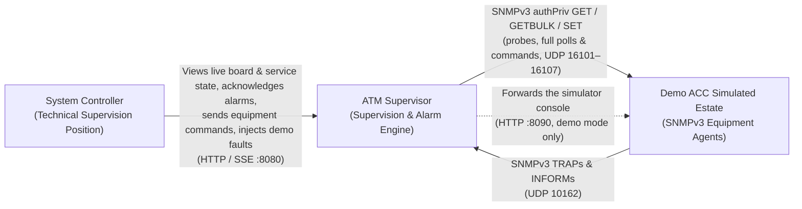
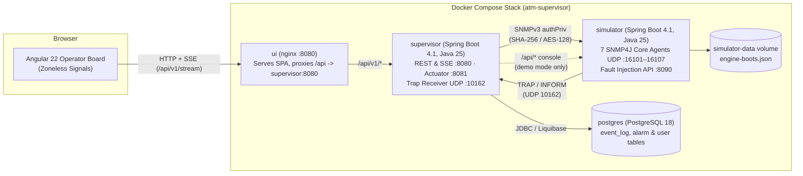
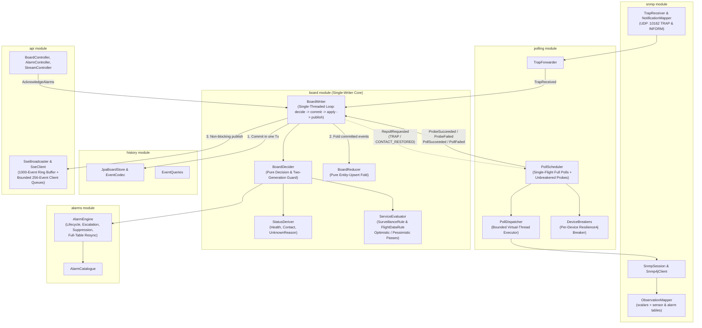
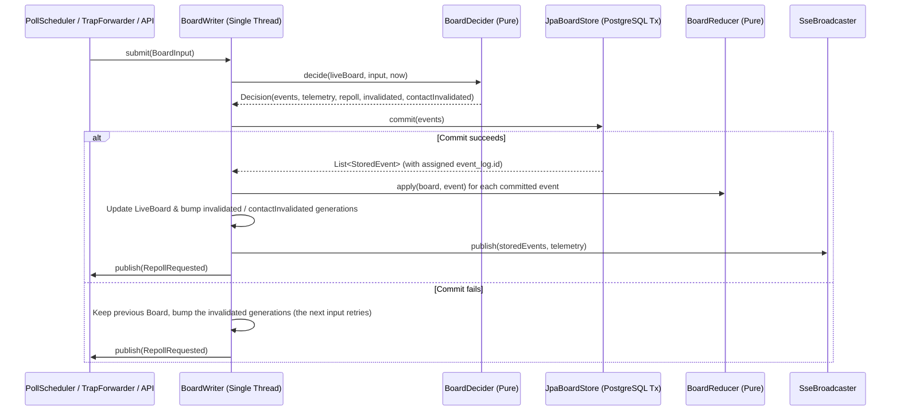

# System Architecture

This document describes the architecture of **ATM Supervisor** as implemented in **v0.1.1**, together with how the planned phases (`v0.2`–`v1.0`) fit into the same module boundaries. For the full target specification see the [design document](design/2026-11-13-atm-supervisor-design.md) and the [architecture review decisions](refactor/ATM-Supervisor-Architecture-Review-Decisions.md).

---

## 1. C4 Architecture Views

### 1.1 Level 1 — System Context

### 1.2 Level 2 — Container Diagram (`deploy/docker-compose.yml`)

### 1.3 Level 3 — Supervisor Component & Module View

Inside `supervisor/`, Spring Modulith enforces six acyclic modules ([`ModularityTest`]):

---

## 2. Core Runtime Pipelines

### 2.1 Probes, Full Polls, Circuit Breakers, and the Two Generations

To prevent the circuit breaker from masking contact loss or delaying recovery ([ADR-0008](adr/0008-independent-probes-two-generations-and-crash-safe-commands.md), [Hazard H1](safety/hazard-log.md#h1-stale-observations-shown-as-current), [Hazard H3](safety/hazard-log.md#h3-circuit-breaker-state-masks-contact-loss)):

1. **Lightweight Probes (`sysUpTime.0`):**
   * Scheduled by [`PollScheduler`] at the device's poll interval (`5 s ± 10 %` jitter) and executed on [`PollDispatcher`] **without** passing through [`DeviceBreakers`].
   * Probes are the sole authority for `reachable`, `consecutiveFailures`, `UNKNOWN (LOST_CONTACT)` (after 3 failed probes), and alarm `901`.
   * Probes carry the device's **`contactGeneration`** (`LiveBoard.contactGeneration(id)`), which is bumped **only** when contact changes (`CONTACT_LOST` or `CONTACT_RESTORED`). Because traps do not bump `contactGeneration`, a trap flood cannot discard failed probes and mask a lost contact.
2. **Full Polls (`GET` scalars + `GETBULK` tables):**
   * Run through the per-device Resilience4j circuit breaker in [`DeviceBreakers`] (count-based window of 5 calls, minimum 3 calls, 50 % failure threshold, 30 s wait in `OPEN`, 1 permitted call in `HALF_OPEN`, no automatic time-based `OPEN → HALF_OPEN`).
   * At most **one** full poll runs per device at a time (single-flight). Traps arriving during an active poll set a pending refresh flag so exactly one follow-up poll runs when the active poll completes.
   * Every full poll walks `atmTsAlarmTable` (`AtmTsOids.ALARM_ENTRY`) in addition to the device's scalars and type-specific tables ([`PollPlan`]). If the alarm walk fails midway or a row is malformed, [`ObservationMapper`] fails the entire observation (`PollFailed`) so a partial walk never clears alarms.
   * Full polls carry the device's **`statusGeneration`** (`LiveBoard.generation(id)`), which is bumped by traps and by contact changes.
3. **Immediate `HALF_OPEN` Verification When Contact Returns:**
   * When a probe succeeds for a device in `LOST_CONTACT`, [`BoardDecider`] emits `CONTACT_RESTORED` (setting health to `UNKNOWN (AWAITING_STATUS)`) and requests `RepollRequested(id, Reason.CONTACT_RESTORED)`.
   * [`PollScheduler.onRepoll`] moves an `OPEN` breaker for that device to `HALF_OPEN` and schedules an immediate full poll. If that verification poll succeeds, the breaker closes and health becomes `OPERATIONAL`/`DEGRADED`/`FAILED`; if it fails, the breaker reopens and the device stays `UNKNOWN`.
   * If probes continue to succeed for a device whose health was known, but no full poll succeeds for more than **3× the poll interval**, [`StatusDeriver`] sets health to `UNKNOWN (STATUS_UNAVAILABLE)`.

### 2.2 The Single-Writer Loop (`BoardWriter`)

All board inputs (`ProbeSucceeded`, `ProbeFailed`, `PollSucceeded`, `PollFailed`, `TrapReceived`, `AcknowledgeAlarms`, `Startup`, `HeartbeatTick`, `Shutdown`) are processed sequentially on the single [`BoardWriter`] thread:

### 2.3 Two-Pass Service Evaluation & Confirmed Facts (`ServiceEvaluator`)

[`ServiceEvaluator`] runs every [`ServiceRule`] ([`SurveillanceRule`], [`FlightDataRule`]) twice:
1. **Optimistic pass (`best`):** Every `UNKNOWN` device is treated as available (`OPERATIONAL`).
2. **Pessimistic pass (`worst`):** Every `UNKNOWN` device is treated as unavailable (`FAILED`).

* **If `best.status() != worst.status()`:** The service state is `UNKNOWN` with `bestCase = best.status()`, and its reason names the `UNKNOWN` equipment the result depends on.
* **If `best.status() == worst.status()`:** That is the confirmed service status. Its `redundancyLost` flag and confirmed reasons come from `best`, while any extra reasons present only in `worst` are reported as a single `"Unconfirmed: … (equipment in UNKNOWN state: …)"` reason.
* **Alarm `903` follows confirmed facts only:** when the two passes disagree on `redundancyLost`, the service state is marked `redundancyUnconfirmed` and [`BoardDecider`] passes no redundancy fact to [`AlarmEngine`], so alarm `903` (*Service redundancy lost*) is neither raised nor cleared.

### 2.4 Bounded SSE Fan-Out (`SseBroadcaster` & `SseClient`)

* [`SseBroadcaster`] holds a **1,000-event ring buffer** of committed [`StoredEvent`] records.
* Each connected browser owns a [`SseClient`] with a bounded **256-entry durable queue** plus a latest-only coalescing map for volatile `telemetry` messages.
* If a slow browser fills its 256-entry durable queue, [`SseBroadcaster`] disconnects it (`reason="overflow"`) instead of blocking [`BoardWriter`] or dropping durable events. On reconnect, the browser resumes from `Last-Event-ID` or receives `event: resync` and refetches `GET /api/v1/board`.

---

## 3. Persistence Schema (Liquibase changelog)

The schema is created by the Liquibase changelog [`db.changelog-master.yaml`](../supervisor/src/main/resources/db/changelog/db.changelog-master.yaml), whose SQL changesets live in [`changes/`](../supervisor/src/main/resources/db/changelog/changes). Changeset `003` loads the demo accounts only in demo mode ([ADR-0009](adr/0009-postgresql-and-liquibase.md)).

| Table | Purpose | Key Columns & Constraints |
|---|---|---|
| `event_log` | Append-only log of all equipment, service, alarm, supervisor lifecycle, and 30 s `TELEMETRY_SAMPLED` events. | `id bigint generated always as identity`, `occurred_at` and `recorded_at` (`timestamptz(3)`), `type`, `entity_kind`, `entity_id`, `equipment_id`, `actor`, `payload jsonb` (full new entity state + `schemaVersion`; alarm events also record `via`). Indexed on `(occurred_at)`, `(equipment_id, occurred_at)` and `(type, occurred_at)`. |
| `alarm` | Open and closed alarm records. | `id`, `equipment_id`, `code`, `instance`, `instance_name`, `severity`, `text`, `source`, `state`, `suppressed`, `raised_at`, `acked_at`, `acked_by`, `ack_comment`, `cleared_at`. The partial unique index `uk_alarm_open` on `(equipment_id, code, instance) where state <> 'CLOSED'` allows one open alarm per identity. |
| `role`, `app_user`, `user_role` | Roles (`VIEWER`, `SUPERVISOR`, `ADMIN`) and accounts. | Usernames are unique and lower case; passwords are stored as `{bcrypt}` hashes. In demo mode, `admin1`, `supervisor1` and `demo1` are created with one role each. |

*(Planned for `v0.3`: `command`, `active_command(equipment_id PRIMARY KEY)` for crash-safe command exclusion, and `snapshot` for 5-minute replay checkpoints.)*

[ModularityTest]: ../supervisor/src/test/java/io/github/selvitopu/atmsup/supervisor/ModularityTest.java
[PollScheduler]: ../supervisor/src/main/java/io/github/selvitopu/atmsup/supervisor/polling/PollScheduler.java
[PollScheduler.onRepoll]: ../supervisor/src/main/java/io/github/selvitopu/atmsup/supervisor/polling/PollScheduler.java
[PollDispatcher]: ../supervisor/src/main/java/io/github/selvitopu/atmsup/supervisor/polling/PollDispatcher.java
[DeviceBreakers]: ../supervisor/src/main/java/io/github/selvitopu/atmsup/supervisor/polling/DeviceBreakers.java
[PollPlan]: ../supervisor/src/main/java/io/github/selvitopu/atmsup/supervisor/snmp/PollPlan.java
[ObservationMapper]: ../supervisor/src/main/java/io/github/selvitopu/atmsup/supervisor/snmp/ObservationMapper.java
[BoardWriter]: ../supervisor/src/main/java/io/github/selvitopu/atmsup/supervisor/board/BoardWriter.java
[BoardDecider]: ../supervisor/src/main/java/io/github/selvitopu/atmsup/supervisor/board/BoardDecider.java
[StatusDeriver]: ../supervisor/src/main/java/io/github/selvitopu/atmsup/supervisor/board/StatusDeriver.java
[ServiceEvaluator]: ../supervisor/src/main/java/io/github/selvitopu/atmsup/supervisor/board/ServiceEvaluator.java
[ServiceRule]: ../supervisor/src/main/java/io/github/selvitopu/atmsup/supervisor/board/ServiceRule.java
[SurveillanceRule]: ../supervisor/src/main/java/io/github/selvitopu/atmsup/supervisor/board/SurveillanceRule.java
[FlightDataRule]: ../supervisor/src/main/java/io/github/selvitopu/atmsup/supervisor/board/FlightDataRule.java
[AlarmEngine]: ../supervisor/src/main/java/io/github/selvitopu/atmsup/supervisor/alarms/AlarmEngine.java
[StoredEvent]: ../supervisor/src/main/java/io/github/selvitopu/atmsup/supervisor/board/StoredEvent.java
[SseBroadcaster]: ../supervisor/src/main/java/io/github/selvitopu/atmsup/supervisor/api/SseBroadcaster.java
[SseClient]: ../supervisor/src/main/java/io/github/selvitopu/atmsup/supervisor/api/SseClient.java
[`AlarmEngine`]: ../supervisor/src/main/java/io/github/selvitopu/atmsup/supervisor/alarms/AlarmEngine.java
[`BoardDecider`]: ../supervisor/src/main/java/io/github/selvitopu/atmsup/supervisor/board/BoardDecider.java
[`BoardWriter`]: ../supervisor/src/main/java/io/github/selvitopu/atmsup/supervisor/board/BoardWriter.java
[`DeviceBreakers`]: ../supervisor/src/main/java/io/github/selvitopu/atmsup/supervisor/polling/DeviceBreakers.java
[`FlightDataRule`]: ../supervisor/src/main/java/io/github/selvitopu/atmsup/supervisor/board/FlightDataRule.java
[`ModularityTest`]: ../supervisor/src/test/java/io/github/selvitopu/atmsup/supervisor/ModularityTest.java
[`ObservationMapper`]: ../supervisor/src/main/java/io/github/selvitopu/atmsup/supervisor/snmp/ObservationMapper.java
[`PollDispatcher`]: ../supervisor/src/main/java/io/github/selvitopu/atmsup/supervisor/polling/PollDispatcher.java
[`PollPlan`]: ../supervisor/src/main/java/io/github/selvitopu/atmsup/supervisor/snmp/PollPlan.java
[`PollScheduler.onRepoll`]: ../supervisor/src/main/java/io/github/selvitopu/atmsup/supervisor/polling/PollScheduler.java
[`PollScheduler`]: ../supervisor/src/main/java/io/github/selvitopu/atmsup/supervisor/polling/PollScheduler.java
[`ServiceEvaluator`]: ../supervisor/src/main/java/io/github/selvitopu/atmsup/supervisor/board/ServiceEvaluator.java
[`ServiceRule`]: ../supervisor/src/main/java/io/github/selvitopu/atmsup/supervisor/board/ServiceRule.java
[`SseBroadcaster`]: ../supervisor/src/main/java/io/github/selvitopu/atmsup/supervisor/api/SseBroadcaster.java
[`SseClient`]: ../supervisor/src/main/java/io/github/selvitopu/atmsup/supervisor/api/SseClient.java
[`StatusDeriver`]: ../supervisor/src/main/java/io/github/selvitopu/atmsup/supervisor/board/StatusDeriver.java
[`StoredEvent`]: ../supervisor/src/main/java/io/github/selvitopu/atmsup/supervisor/board/StoredEvent.java
[`SurveillanceRule`]: ../supervisor/src/main/java/io/github/selvitopu/atmsup/supervisor/board/SurveillanceRule.java
