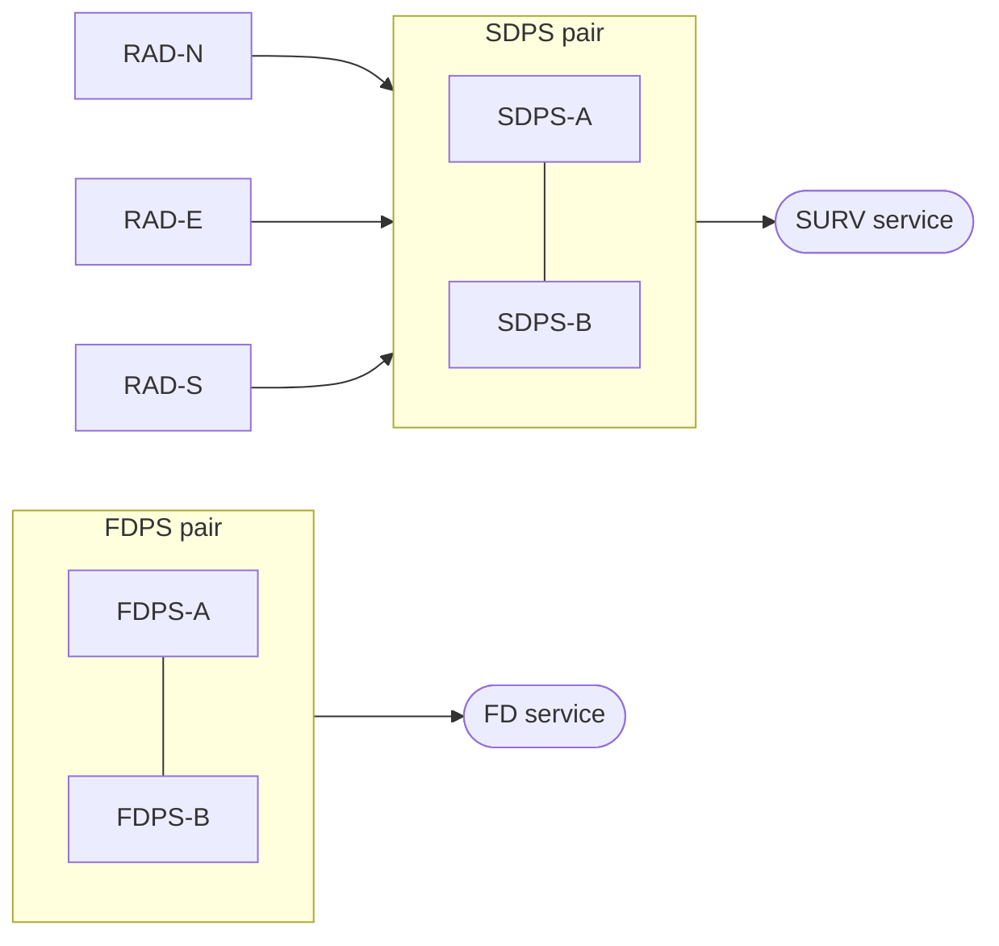
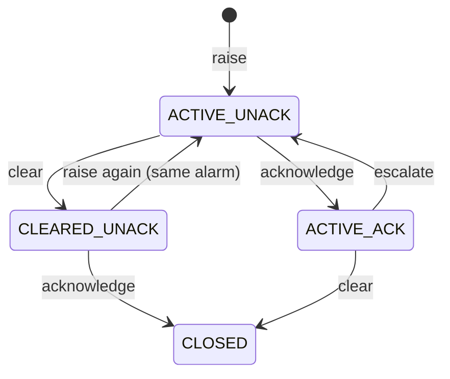

# Domain primer

This page explains the air traffic management (ATM) ideas that ATM Supervisor models. It is written
for backend engineers who are new to the domain. Everything here describes a fictional centre,
**Demo ACC**, and a deliberately simplified model of it. Nothing in this repository is certified or
suitable for operational use.

## Technical supervision is not air traffic control

An area control centre (ACC) gives air traffic control to aircraft en route. Controllers work with
radar pictures, flight data and voice. Behind them runs a large technical estate: radar stations,
the surveillance tracker, the flight data processor, voice switches, radios, recorders and networks.

**Technical supervision** watches that estate. A **System Controller** at a technical supervision
position sees the health of every system, handles alarms, coordinates maintenance, and tells the
operational supervisor what an equipment problem means for the service controllers receive. The
System Controller does not separate aircraft. ATM Supervisor is a tool for that technical position:
it never touches flight or surveillance data itself, only the management interfaces of the systems
(SNMP), and it derives service impact from their state.

## The supervised systems in this release

Demo ACC currently has three device types and seven devices. The other device types in the
[design](design/2026-11-13-atm-supervisor-design.md#5-the-simulated-centre-demo-acc) are planned.

| Device | Type | What it does |
|---|---|---|
| `RAD-N`, `RAD-E`, `RAD-S` | Radar | Mode S radar stations. Each has two transmitter channels, A and B. |
| `SDPS-A`, `SDPS-B` | SDPS | Surveillance data processing: the multi-sensor tracker that turns radar plots into the system tracks controllers see. An active/standby pair. |
| `FDPS-A`, `FDPS-B` | FDPS | Flight data processing: flight plans and the messages that update them. An active/standby pair. |

**Radar to tracker.** Each SDPS unit reports one sensor input row per radar, as `receiving`, `lost`
or `excluded`. When a radar fails, both SDPS units report its input as lost and raise alarm 401
*Sensor input lost* for it. The tracker keeps working on the remaining radars, so one failed radar
is a reduction in coverage depth, not a loss of surveillance.

**Active/standby pairs.** Only the active unit of an SDPS or FDPS pair does the work. If the active
unit fails and the standby is usable (not failed, not in maintenance), the pair switches over about
3 seconds later. The new active unit raises alarm 104 *Switchover occurred*. A pair that has
switched over still works, but it has lost its redundancy.

## Equipment health and service state are different things

Each device has four independent attributes:

- **Health:** `OPERATIONAL`, `DEGRADED` or `FAILED`, as the device reports it, or `UNKNOWN` (below).
- **Maintenance:** a flag, not a health value. A device in maintenance still shows its real health.
- **Role:** `standalone`, `active` or `standby`.
- **Contact:** whether the supervisor can reach it, and when it last could.

A **service** is what the operational side actually depends on. ATM Supervisor derives two services
from equipment state, with one small rule class each:

| Service | `FAILED` when | `DEGRADED` when |
|---|---|---|
| `SURV` surveillance ([`SurveillanceRule`](../supervisor/src/main/java/io/github/selvitopu/atmsup/supervisor/board/SurveillanceRule.java)) | No SDPS unit is available, or no radar is available | Only one SDPS unit is available, or fewer than 2 radars are available |
| `FD` flight data ([`FlightDataRule`](../supervisor/src/main/java/io/github/selvitopu/atmsup/supervisor/board/FlightDataRule.java)) | No FDPS unit is available | Only one FDPS unit is available |

Otherwise the service is `OK`. A device is **available** when its health is `OPERATIONAL` or
`DEGRADED` and it is not in maintenance, so maintenance counts as a planned outage. A service that
is down to one unit also raises supervisor alarm 903 *Service redundancy lost*, and a failed service
raises 904 *Service failed*.

## N-1 and single points of failure

Engineers who plan work on a centre ask "what if one more thing fails?". That is **N-1**: with everything as it is
now, or with some units already out for maintenance, would the loss of any one further unit cost a service? A unit
whose loss would is a **single point of failure** for that service, even though nothing is wrong yet. With `FDPS-A`
and `FDPS-B` both operational, neither is a single point of failure for `FD`. With `FDPS-B` in maintenance, `FDPS-A`
is one.

Because the service rules above are functions of which units are available, N-1 needs no new model. The impact
analysis reruns the same rules with the extra units counted as unavailable and compares the result with the
reference: the board as it is for a maintenance plan, or the board with the plan applied for N-1. It gives one of
three verdicts:

- **`SERVICE LOSS`:** a service that is not failed would become `FAILED`.
- **`REDUCED MARGIN`:** no service would fail, but one gets worse (`OK` to `DEGRADED`), newly loses redundancy or gains
  a reason.
- **`NO SERVICE IMPACT`:** nothing changes. This is not a clearance: it says only what the rules count.

A unit in `UNKNOWN` state (see the next section) is never read as healthy. The analysis tries every possible state
of the `UNKNOWN` units, each one working or not, and gives the worst verdict across them, marked unconfirmed when they
disagree. The unit asked about, or planned, counts as working now, because "if it failed" and "take it out" presume
that it works. Up to 10 `UNKNOWN` units are tried exactly; beyond that, the analysis uses a conservative bound, which
can only overstate. The rules know nothing about roles, so planning an active unit adds a note that the pair
switches over, and the verdict stays as the rules give it. The analysis is a view of the rules, and it does not model
a switchover's brief interruption or a radar's coverage; it is not a safety assessment.

## `UNKNOWN` belongs to the supervisor

Devices only ever report `OPERATIONAL`, `DEGRADED` or `FAILED`. `UNKNOWN` is the supervisor saying
"I cannot confirm this device's health right now". It always overrides the last known value and
always carries a reason:

| Reason | Meaning |
|---|---|
| `NOT_YET_POLLED` | No successful poll yet. |
| `LOST_CONTACT` | Three consecutive probes failed, about 15 s at the default 5 s interval. |
| `AWAITING_STATUS` | Contact is back, but no full poll has confirmed the health yet. |
| `STATUS_UNAVAILABLE` | Probes succeed, but no full poll has succeeded for more than 3 poll intervals. |
| `SUPERVISOR_RESTARTED` | The supervisor restarted and has not polled the device yet. |

`UNKNOWN` is never shown as green or `OK`. For a service, the supervisor evaluates the rule twice:
once with every `UNKNOWN` device treated as available, and once with every `UNKNOWN` device treated
as unavailable.

- **Both passes agree:** that is the service state, because the unknown devices cannot change it.
  A known failure is therefore never hidden behind "unknown". Only confirmed reasons are shown, plus
  one "Unconfirmed: …" reason naming the unknown equipment.
- **The passes disagree:** the service is `UNKNOWN` and shows its best case, for example
  "UNKNOWN · at best OK".

Service alarms follow confirmed facts only. If the passes disagree on whether redundancy is lost,
alarm 903 is neither raised nor cleared until the facts are confirmed.

## Lost contact is not equipment failure

When the supervisor cannot reach a device's management agent, it knows nothing new about the
device, and that is all it knows. The radar may still be turning and feeding the tracker. In the
simulator, a radar whose SNMP agent stops answering keeps feeding both SDPS units, exactly as a real
radar would behind a broken management link.

So lost contact makes the device `UNKNOWN (LOST_CONTACT)` and raises alarm 901 *Lost contact*. It
does not make the device `FAILED`, and it does not clear its open alarms: they stay open with an
"unconfirmed" marker, because the supervisor cannot confirm that they cleared. When contact
returns, the device stays `UNKNOWN (AWAITING_STATUS)` until a full poll confirms its health, and
that poll reconciles the alarms against the device's own alarm table.

## Alarms

An alarm is identified by equipment, code and instance (for example `SDPS-A`, 401, sensor `RAD-N`).
There is at most one open alarm per identity. Its lifecycle is the usual one in alarm handling:
an alarm closes only when it is both cleared and acknowledged.

- **Escalation** to a higher severity makes an acknowledged alarm unacknowledged again, because the
  operator must see it. **De-escalation** keeps the acknowledgement.
- **Maintenance:** alarms from a device in maintenance are still recorded, but flagged as suppressed
  and hidden by default.
- **Device alarms** come from traps and from the device's alarm table. **Supervisor alarms** are
  derived by the supervisor: 901 lost contact, 903 redundancy lost and 904 service failed.
- **Traps are hints.** A trap raises or clears an alarm at once, but every full poll walks the
  device's alarm table and corrects the supervisor's view, so a lost trap cannot hide an alarm
  beyond the next successful full poll.

## Correlated alarms and floods

One failure raises several alarms. When `RAD-N` fails, the supervisor raises five: `101 Equipment failed`,
`201 Channel A failed` and `202 Channel B failed` on the radar, and a `401 Sensor input lost` on each SDPS unit. A
list with one row per alarm leaves the System Controller to work out that these are one incident. The supervisor
does that grouping with three fixed rules. An alarm that a known failure explains is a *correlated alarm*. The
`101` it is linked to is its *cause*.

| Rule | Which alarm | Linked to | Example |
|---|---|---|---|
| `SENSOR_INPUT` | An SDPS `401` for a radar | That radar's `101` | `SDPS-A` `401` for `RAD-N` → `RAD-N` `101` |
| `SWITCHOVER` | A `104 Switchover occurred` on a paired unit | Its partner's `101` | `FDPS-B` `104` → `FDPS-A` `101` |
| `SAME_UNIT` | Any other device alarm on a unit, except `101` and `103` | That unit's own `101` | `RAD-N` `201` → `RAD-N` `101` |

- **The shape picks the rule.** A `401` for `RAD-N` is only ever linked to `RAD-N`'s `101`, even when `SDPS-A` has
  failed too. Whether a cause is open only decides whether a link is made, so the order in which traps arrive never
  changes a link. A cause that arrives after its correlated alarms adopts them.
- **A cause is a failed unit's `101`** that is still active. The grouping stops when the cause is cleared.
- **Never worse than the cause.** A correlated alarm is never more severe than its cause. If it escalates above the
  cause, or the cause de-escalates below it, the link is removed.
- **Grouped, never hidden.** A correlated alarm is still raised, counted, stored and acknowledgeable. The alarm list
  shows it under its cause only while the cause is active and shown, and on its own otherwise.
- **Recorded, not recomputed.** The link is stored with the alarm when it is made, and each change is a stored event, so
  replay can rebuild the grouping at any moment, whatever the rules say later.

**Service and contact alarms are never correlated.** The service alarms `903` and `904` are the operational impact,
not a symptom: the System Controller passes them on to the operational supervisor, so they always stay top-level
rows. A service alarm also usually has several causes, and one link would misstate that. Lost contact (`901`) is not
equipment failure, as the section above explains. A radar behind a broken management link can still feed the tracker.
If the SDPS units report a radar's input lost while the radar is also unreachable, that points to the radar site, but
the supervisor does not guess, so both alarms stay top-level.

**An alarm flood** is a rate of new alarms that nobody can read one by one. Alarm-management practice (ISA-18.2 and
EEMUA 191) takes about 10 new alarms in 10 minutes for one operator as the benchmark. The supervisor starts the
`ALARM FLOOD` state when 10 alarms have been raised in the last 10 minutes, and ends it when fewer than 5 have. The
end threshold is this project's own choice: the gap between 10 and 5 stops the indicator flapping on and off. Alarms
of a device in maintenance are hidden by default and do not count; correlated alarms do, because the rate measures
what arrives. During a flood, read the cause rows first and expect more alarms.

## Replay shows samples, and shows gaps

After an incident the question is what the board showed at a given moment. The supervisor answers it from its event
log, which stores every state change in order. The board at 14:02 is rebuilt by taking a stored copy of the board
(one every 5 minutes, and one at every start) and applying the events after it, with the same rules the live board
uses. Replay therefore cannot disagree with what the System Controller saw.

Three things are different from live, and the Replay screen says so:

- **Values are samples.** Telemetry is stored every 30 seconds, not at every 5-second poll, so a replayed value is the
  newest sample at or before the instant, shown with the time it was taken. Nothing is interpolated or filled in, and
  there is no freshness age, because the screen has no "now". Health is not sampled: it comes from the recorded
  events.
- **A gap is not a healthy board.** The supervisor records a heartbeat every 60 seconds. If an instant has no recorded
  event (other than a sample) in the 90 seconds before it, or the last one is a supervisor stop, or it is before the
  first record, nothing was being supervised, and replay says `No recorded data: supervisor not running`. Silence is
  never shown as `OK`.
- **A restart is a boundary.** A supervisor restart turns every unit `UNKNOWN (SUPERVISOR_RESTARTED)` at that instant.
  Because the board at start-up is itself rebuilt from the log, a unit keeps the time it became `UNKNOWN` and its last
  contact across a restart, and live and replay agree.

A command is recorded twice, as an intent and then as an outcome, under one command id. In an incident report the two
are shown as one command, and an intent whose outcome was never recorded (the supervisor stopped in between) shows as
`outcome not recorded`, never as success and never dropped.

## What is simplified

- **No real data.** Radar plots, tracks and flight plans appear only as counters and rates. Nothing
  processes real surveillance or flight data.
- **A small estate.** Three device types and two services today. Voice, radio, recording, ADS-B and
  network supervision are planned.
- **Availability only.** The service rules count available units. A `DEGRADED` active unit does not
  yet degrade its service.
- **Three roles.** A VIEWER watches the board and the alarm history. A SUPERVISOR also acknowledges
  alarms, sends equipment commands (maintenance, restart, make active) and, in the demo centre,
  injects training faults. An ADMIN can do all of that and manages the accounts. Every role can replay history and export an incident report.
- **One supervisor.** The supervisor itself is not redundant.
- **Illustrative values.** Alarm codes, severities, thresholds and timings are plausible defaults,
  not taken from any real system.

## Glossary

| Term | Meaning |
|---|---|
| ACC | Area control centre: the unit that controls traffic en route. |
| ADS-B | Automatic Dependent Surveillance–Broadcast: aircraft broadcast their own position. |
| AFTN, OLDI | The networks over which flight data messages arrive: the aeronautical fixed telecommunication network, and on-line data interchange between neighbouring centres. |
| Alarm flood | New alarms arriving faster than a person can read them: here, 10 in 10 minutes, ending below 5. The board shows `ALARM FLOOD` while it lasts. |
| Cause | The `101 Equipment failed` alarm of a failed unit, to which the alarms it explains are linked. |
| CNS | Communication, navigation and surveillance: the technical infrastructure behind ATM. |
| Correlated alarm | An alarm that a known failure explains, linked to that failure's alarm (its cause) by a topology rule and listed under it. |
| Degraded mode | Operation with reduced capability or without redundancy. |
| FDPS | Flight data processing system. |
| Gap | A period with no recorded event other than a telemetry sample for more than 1.5 heartbeats (90 s by default): the supervisor was not running. Replay shows `No recorded data`. |
| Mode S | A secondary surveillance radar mode that interrogates aircraft selectively. |
| Replay | The board as it was at a past instant, rebuilt from the event log and played forward, with samples marked and gaps shown. |
| SDPS | Surveillance data processing system: the multi-sensor tracker. |
| System Controller | The person at the technical supervision position. |
