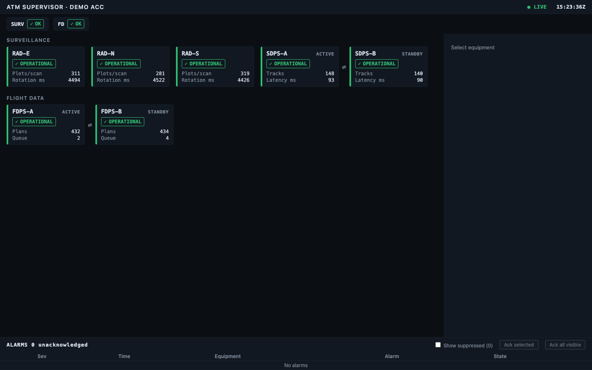
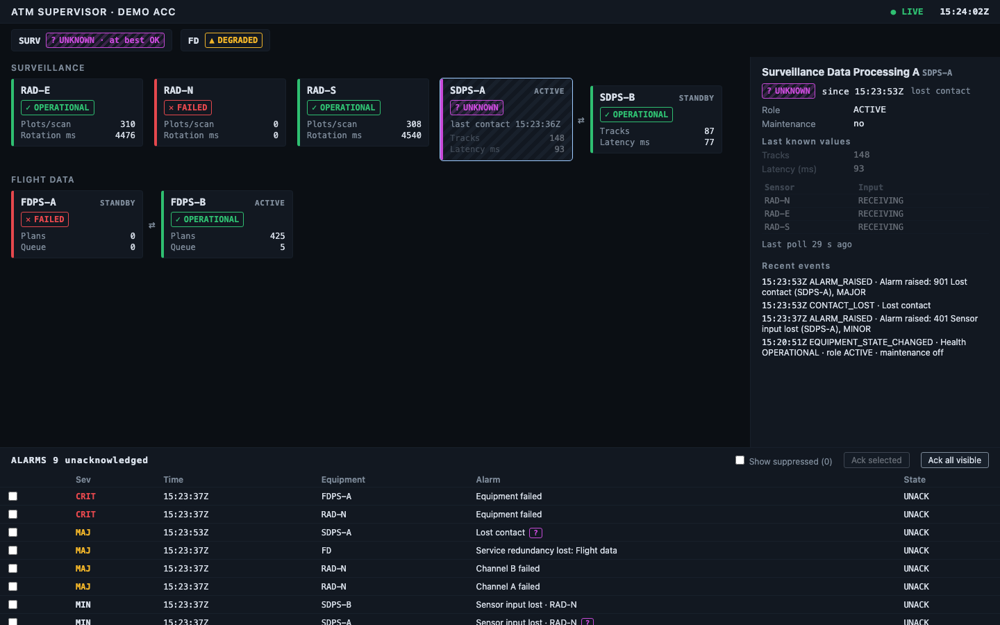

# User and Operator Guide

This manual is a practical, hands-on guide to starting, reading, operating, and troubleshooting **ATM Supervisor** (`v0.1.1`). It covers every part of the operator screen, step-by-step operational playbooks, the supervisor and simulator REST APIs, direct SNMPv3 commands, and common troubleshooting checks.

For domain background on technical supervision in an Area Control Centre, see the [domain primer](domain.md). For a scripted tour of v0.1, see the [demo walkthrough](demo-v0.1.md).

---

## 1. Starting, Resetting, and Stopping the Stack

### 1.1 First-Time Build (Online)

From the repository root, build the container images, start the stack, reset the simulator, and wait until all 7 devices report `OPERATIONAL`:

```sh
scripts/demo-preflight.sh --build
```

When the stack is ready, the script prints:

```text
READY  7/7 OPERATIONAL  SURV OK  FD OK  http://localhost:8080
```

### 1.2 Everyday Start and Clean Reset (Offline)

Once the images are built, the stack needs no internet connection:

```sh
# Start (or reuse) the running stack and reset all simulator faults
scripts/demo-preflight.sh

# Wipe all stored alarms, event history, and engine boot counters first
scripts/demo-preflight.sh --fresh
```

You can also manage the stack directly with Docker Compose from the repository root:

```sh
docker compose up -d --wait
docker compose down          # stop containers, keep the database & engine-boots volumes
docker compose down -v       # stop containers and delete volumes
```

Open **<http://localhost:8080>** in your browser.

### 1.3 Signing In

The board opens with the sign-in screen. In demo mode it lists three accounts; select one to fill in the form:

| Account | Role | What it can do |
|---|---|---|
| `admin1` | ADMIN | Everything a supervisor can, plus the **Users** screen |
| `supervisor1` | SUPERVISOR | Acknowledge alarms, send equipment commands, and use the **Simulator** screen |
| `demo1` | VIEWER | View the board |

Each password is the account name followed by `-demo`. **Create a read-only account** registers a new VIEWER. When a
session ends (after 12 hours without the board open, or when the supervisor restarts), the board returns to the
sign-in screen with the notice *Your session ended. Sign in again.* **Sign out** is at the right of the header; it
ends the session in every window at once, and so does an administrator's change to your account.

---

## 2. Screen Tour: Reading the Operator Board

The operator console is a full-viewport grid divided into four regions: the **Header Bar**, the **Services Strip**, the **Equipment Board & Detail Panel**, and the **Alarms Pane**.



### 2.1 Top Header Bar (`ATM SUPERVISOR · DEMO ACC`)

* **Connection Status Indicator:**
  * `● LIVE` (green) — Connected to the Server-Sent Events stream (`/api/v1/stream`).
  * `◌ RECONNECTING` (amber) — Stream interrupted; the browser is reconnecting and will automatically replay missed events (via `Last-Event-ID`) or refetch `/api/v1/board`.
  * `✕ OFFLINE` (red) — Disconnected.
* **UTC Clock:** Displays server-synchronised UTC time with a `Z` suffix (for example `15:24:18Z`).
* **`DATA NOT LIVE` Safety Overlay:** If the SSE stream remains down for more than **10 seconds**, a diagonal hatched overlay covers the board so an operator cannot mistake a frozen browser tab for live supervision.

### 2.2 Operational Services Strip (`SURV` and `FD`)

Immediately below the header sits the services strip:

* **`SURV` (Surveillance):** Summarises whether controllers have a working multi-sensor tracker (`SDPS-A/B`) fed by at least two radars (`RAD-N/E/S`).
* **`FD` (Flight Data):** Summarises whether controllers have a working flight data processor (`FDPS-A/B`) with standby redundancy.
* **Hover Tooltip (`title`):** Hovering over a service chip shows the exact reasons behind its current status (for example, `"Fewer than 2 radars available; Only one SDPS unit available"` or `"Unconfirmed: Only one SDPS unit available (equipment in UNKNOWN state: SDPS-B)"`).

### 2.3 Status Badges (Colour + Symbol + Text)

Status is never communicated by colour alone:

| Badge | Symbol | Colour | Meaning |
|---|---|---|---|
| **`✓ OPERATIONAL`** / **`✓ OK`** | `✓` | Green | Confirmed healthy. |
| **`▲ DEGRADED`** | `▲` | Amber | Working with reduced capability (e.g. one radar channel failed, or fewer than 2 radars available) or without standby redundancy (down to one SDPS or FDPS unit). |
| **`✕ FAILED`** | `✕` | Red | Confirmed unable to perform its operational function. |
| **`? UNKNOWN`** | `?` | Violet (hatched) | The supervisor cannot confirm the current state. On a service chip, it also shows the optimistic upper bound: **`? UNKNOWN · at best OK`** or **`? UNKNOWN · at best DEGRADED`**. |

### 2.4 Equipment Tiles (`SURVEILLANCE` and `FLIGHT DATA`)



Each equipment tile (`RAD-N`, `RAD-E`, `RAD-S`, `SDPS-A`, `SDPS-B`, `FDPS-A`, `FDPS-B`) displays:

1. **Identifier & Pair Role:** The top row shows the device ID (`SDPS-A`) and, for redundant pairs, its current role (`ACTIVE` or `STANDBY`).
2. **Health Badge & `MAINT` Tag:**
   * Shows the health badge (`✓ OPERATIONAL`, `▲ DEGRADED`, `✕ FAILED`, or `? UNKNOWN`).
   * If `atmTsEqMaintenanceMode` is enabled on the device, a blue **`MAINT`** badge is shown *next to* its real hardware health.
3. **`UNKNOWN` Reason & Last Contact Note:**
   * When a device is `? UNKNOWN`, the tile becomes diagonally hatched and shows why:
     * `last contact <HH:MM:SSZ>` — when `LOST_CONTACT` (after 3 failed lightweight probes, ~15 s).
     * `awaiting status` — contact just returned on a probe, waiting for the immediate verification full poll.
     * `status unavailable` — lightweight probes succeed, but full polls have failed for `> 3×` the poll interval.
     * `not yet polled` — before the first poll on a fresh start.
     * `supervisor restarted` — after a supervisor restart before the first poll completes.
   * While `UNKNOWN`, the tile's numerical summary values (`Plots/scan`, `Rotation ms`, `Tracks`, `Latency ms`, `Plans`, `Queue`) are **dimmed (`40%` opacity)** so they are never read as current measurements.
4. **Amber Stale-Poll Age (`N s ago`):**
   * Under normal polling (every 5 s), tiles stay uncluttered. If more than **2× the poll interval (> 10 s)** passes since `lastPollAt` before the device reaches `LOST_CONTACT`, an amber **`11 s ago`** warning appears on the tile.

### 2.5 Equipment Detail Panel (Right-Hand Drawer)

Click any equipment tile to select it (deep-linked at `/board/:equipmentId`, for example <http://localhost:8080/board/SDPS-A>):

* **Header & State Duration:** Shows the full name (`Surveillance Data Processing A SDPS-A`), health badge, `since <HH:MM:SSZ>`, and any `UNKNOWN` reason label.
* **Role & Maintenance:** Shows `Role` (`ACTIVE`, `STANDBY`, `STANDALONE`) and `Maintenance` (`MAINT` or `no`).
* **Device Values & Sub-Component Tables:**
  * If the device is `UNKNOWN`, a **`Last known values`** heading appears and the values are dimmed.
  * **Radar (`RAD-N/E/S`):** `Rotation (ms)`, `Plots/scan`, `Active channel` (`CHANNEL_A` / `CHANNEL_B`), `Channel A` status, and `Channel B` status.
  * **SDPS (`SDPS-A/B`):** `Tracks`, `Latency (ms)`, plus the **`Sensor / Input` table** listing each radar (`RAD-N`, `RAD-E`, `RAD-S`) as `RECEIVING`, `LOST`, or `EXCLUDED`.
  * **FDPS (`FDPS-A/B`):** `Flight plans`, `Queue depth`, and `Latency (ms)`.
* **Poll Freshness (`Last poll N s ago`):** Ticks every second against server time.
* **Recent Events:** Lists up to the last **50 durable events** recorded in PostgreSQL for this device (`EQUIPMENT_STATE_CHANGED`, `CONTACT_LOST`, `CONTACT_RESTORED`, `ALARM_RAISED`, `ALARM_CLEARED`, etc.) with their UTC timestamps and human-readable summaries.

* **Control (supervisors and administrators):** **Maintenance on** or **Maintenance off**, **Restart** (only in
  maintenance, and not while a restart is in progress), and **Make active** (for the standby unit of a pair, enabled
  only while it is operational and not in maintenance). A greyed-out button says why when you point at it. See
  Playbook 4.

### 2.6 Alarms Pane (Bottom Bar & Table)

The bottom pane tracks every open alarm (`ACTIVE_UNACK`, `ACTIVE_ACK`, `CLEARED_UNACK`):

* **Ordering:** Rows are sorted automatically by **severity** (`CRIT` $\rightarrow$ `MAJ` $\rightarrow$ `MIN` $\rightarrow$ `WARN`) and then by **raise time** (newest first).
* **Columns:**
  * Checkbox (for selecting individual alarms)
  * `Sev` (`CRIT`, `MAJ`, `MIN`, `WARN`)
  * `Time` (UTC timestamp when the alarm was raised)
  * `Equipment` (`RAD-N`, `SDPS-A`, or service ID `SURV` / `FD` for supervisor alarms `903`/`904`)
  * `Alarm` (description, instance name such as `· RAD-N`, and a violet **`?`** badge if the equipment is currently `UNKNOWN` and its alarms are therefore **unconfirmed**)
  * `State` (`UNACK`, `ACK`, or `CLEARED-UNACK`)
* **Controls:**
  * **`Show suppressed (N)` checkbox:** Reveals alarms raised by devices that are in `MAINT` mode (hidden by default so planned work does not flood the watch).
  * **`Ack selected` button:** Acknowledges the checked rows.
  * **`Ack all visible` button:** Acknowledges every `UNACK` and `CLEARED-UNACK` alarm currently visible in the table.

---

### 2.7 Alarm History

**Alarm history** in the header searches every alarm, open or closed, newest first. Filter by state (`All` or
`Open`), severity, equipment, and a **From/To** range in UTC, then click **Search**. Each row shows when the alarm
was raised, who acknowledged it and when, and when it cleared. **Previous** and **Next** page through 50 alarms at a
time.

### 2.8 Simulator (Demo Centre Only)

Supervisors and administrators see **Simulator** in the header when the stack runs in demo mode. It lists each
simulated device with its status, role, whether it answers SNMP, and its active faults, and offers the faults its type
supports: **Fail**, **Degrade**, **Channel A fail** and **Channel B fail** (radars), **Sensor lost** with the radar it
concerns (SDPS), **Unreachable**, **Drop traps**, and **Recover**. **Reset all** asks for a confirmation first. The
screen refreshes every two seconds. Outside demo mode the screen and its API do not exist.

### 2.9 Users (Administrators)

**Users** lists every account with its role and whether it is enabled. An administrator can change a role and
**Save**, **Disable** an account after a confirmation or **Enable** it again, and **Set password** under the same rule
as registration. Every change signs that user out at once, in every window. Your own row is read-only, so an
administrator cannot lock themselves out.

---

## 3. Hands-On Operational Playbooks

You can run these five workflows against the live stack to see how the board responds to faults, acknowledgements,
switchovers, lost contact, and maintenance. Sign in as `supervisor1`, keep the board open in one browser window, and
open the **Simulator** screen from the header in a second window, so you can inject a fault and watch the board react.
**Reset all** on the Simulator screen clears every fault and restores the default roles.

### Playbook 1: Degrade a Radar Channel, Fail the Radar, and Acknowledge Alarms

1. **Inject a single-channel fault on `RAD-N`:**
   On the **Simulator** screen, click **Channel A fail** in the `RAD-N` row.
   * **What you see:** `RAD-N` turns **`▲ DEGRADED`**. Click the `RAD-N` tile: the detail panel shows `Active channel: CHANNEL_B`, `Channel A: FAILED`, `Channel B: OPERATIONAL`. Two `MIN` alarms appear: `102 Equipment degraded` and `201 Channel A failed`. Because `RAD-N` is still producing plots on Channel B, `SDPS-A/B` still show `RAD-N: RECEIVING` and `SURV` stays **`✓ OK`**.
2. **Fail `RAD-N` completely:**
   On the **Simulator** screen, click **Fail** in the `RAD-N` row.
   * **What you see:** `RAD-N` turns **`✕ FAILED`** with `CRIT` alarm `101 Equipment failed`, and `201`/`202` escalate to `MAJ`. Both `SDPS-A` and `SDPS-B` raise `MIN` alarm `401 Sensor input lost · RAD-N`. `SURV` *still* stays **`✓ OK`** because 2 radars (`RAD-E` and `RAD-S`) remain available.
3. **Acknowledge the alarms:**
   * Click **Ack all visible** in the alarm bar. Every row changes from `UNACK` to `ACK` and `0 unacknowledged` is shown, while the rows remain visible because the faults are still active.
4. **Recover `RAD-N`:**
   On the **Simulator** screen, click **Recover** in the `RAD-N` row.
   * **What you see:** Because you already acknowledged the alarms, they transition directly from `ACK` to `CLOSED` and disappear from the open alarm list as soon as `RAD-N` recovers. (Any alarm you did *not* acknowledge transitions to `CLEARED-UNACK` and waits for your acknowledgement before closing.)

---

### Playbook 2: Observe an Automatic 3-Second A/B Pair Switchover

1. **Fail the active Flight Data Processor (`FDPS-A`):**
   On the **Simulator** screen, click **Fail** in the `FDPS-A` row.
2. **Watch the two-step transition on the board:**
   * **Immediately ($t = 0\text{ s}$):** `FDPS-A` turns **`✕ FAILED`** (`101 Equipment failed`), `FD` turns **`▲ DEGRADED`** (`Only one FDPS unit available`), and supervisor alarm **`903 Service redundancy lost: Flight data`** (`MAJ`) is raised.
   * **After 3 seconds ($t \approx 3\text{–}4\text{ s}$):** The pair switches over automatically: `FDPS-B` becomes **`ACTIVE`**, `FDPS-A` becomes **`STANDBY`** (still `✕ FAILED`), and `FDPS-B` raises `WARN` alarm **`104 Switchover occurred`**. `FD` remains **`▲ DEGRADED`** because the pair has no healthy standby left.

---

### Playbook 3: Lost Contact (`UNREACHABLE`) and Fast Probe Recovery

1. **Cut SNMP communication to `SDPS-B`:**
   On the **Simulator** screen, click **Unreachable** in the `SDPS-B` row.
2. **Observe the progression:**
   * **At ~10 s:** An amber poll age (`11 s ago`) appears on the `SDPS-B` tile.
   * **At ~15 s (3 failed probes):** `SDPS-B` turns **`? UNKNOWN`** (`last contact <UTC>`) with dimmed values, and raises `MAJ` alarm **`901 Lost contact`** with the unconfirmed **`?`** marker.
   * Look at the `SURV` chip in the services strip: it turns **`? UNKNOWN · at best OK`** because whether surveillance still has full SDPS redundancy depends on the unreachable `SDPS-B`.
3. **Restore communication:**
   On the **Simulator** screen, click **Recover** in the `SDPS-B` row.
   * Within one probe interval (≤ 5 s), `SDPS-B`'s lightweight `sysUpTime.0` probe succeeds, moves the device's circuit breaker to `HALF_OPEN`, triggers an immediate verification full poll, and restores `SDPS-B` to **`✓ OPERATIONAL`** and `SURV` to **`✓ OK`**.

---

### Playbook 4: Maintenance Mode, Alarm Suppression, and Equipment Commands

Equipment commands are on the board itself: select a tile, and the detail panel shows a **Control** section to
supervisors and administrators. Every command first shows a confirm bar that names the unit and what will happen;
only **Confirm** sends it. The supervisor sends each command to the unit as an SNMP `SET` with the read-write
`operator` user. It records the command in the event log with your username twice: as *issued* before it is sent,
and again with its outcome. If it cannot record the command, it does not send it, and the panel says *The command was
not sent: it could not be recorded*.

1. **Put `FDPS-B` (`STANDBY`) into maintenance:** select the `FDPS-B` tile, click **Maintenance on**, then **Confirm**.
   * **What you see on the board:**
     * `FDPS-B` keeps its **`✓ OPERATIONAL`** badge and gains the blue **`MAINT`** badge beside it.
     * Because a unit in maintenance counts as unavailable (a planned outage), `FD` turns **`▲ DEGRADED`** (`Only one FDPS unit available`) and raises alarm `903`.
     * Alarm `103 Maintenance mode on` is raised on `FDPS-B`, but because `FDPS-B` is in maintenance, it is **suppressed**! Check **`Show suppressed (1)`** in the alarm bar to see it.
     * **Recent events** in the detail panel lists `Maintenance on by supervisor1: issued`, then
       `Maintenance on by supervisor1: done`.
2. **Restart `FDPS-B` while it is in maintenance:** click **Restart**, then **Confirm**.
   * **Restart** is available only in maintenance. The unit itself enforces this too: a restart it receives outside
     maintenance is refused, and the panel shows the reason. Every result in the panel starts with the unit it
     concerns, for example `FDPS-B: Restart done`.
3. **Take `FDPS-B` out of maintenance, then make it active:** click **Maintenance off** and **Confirm**, then
   **Make active** and **Confirm**. **Make active** appears only for the standby unit of a redundant pair, and is
   enabled only while that unit is operational and out of maintenance, which is why it waits for **Maintenance off**.
   * **What you see:** `MAINT` disappears, `FD` returns to **`✓ OK`**, and `FDPS-B` swaps roles with `FDPS-A` to become **`ACTIVE`**.

---

### Playbook 5: Verify Full-Poll Alarm Reconciliation (`via RESYNC`) When Traps Are Lost

1. **Tell `RAD-S` to drop all outgoing traps and informs, then fail it:**
   On the **Simulator** screen, click **Drop traps** in the `RAD-S` row, then **Fail**.
2. **What you see:** Within at most one 5-second poll interval, `RAD-S` turns **`✕ FAILED`** and alarms `101`, `201`, and `202` appear in the alarm list even though zero traps were sent. Click the `RAD-S` tile: **Recent events** in the detail panel lists the `ALARM_RAISED` events. The event log records each of them with `via: RESYNC` in its payload, because they came from the full poll's alarm-table walk; the board itself does not display the source.

---

## 4. REST API Reference

Every user action has a screen; this reference is for integrators. The interactive OpenAPI page is at
<http://localhost:8080/api/v1/docs>. Every call needs a signed-in session cookie, and every `POST` and `PATCH` also
needs the `X-XSRF-TOKEN` header with the value of the `XSRF-TOKEN` cookie. Refusals are RFC 9457 problem details.

| Method & Path | Role | Description |
|---|---|---|
| `GET /api/v1/board` | VIEWER | The live board snapshot (`centre`, `serverTime`, `lastEventId`, `services`, `equipment`, open `alarms`). |
| `GET /api/v1/equipment/{id}` | VIEWER | The equipment state and its last 50 events (`recentEvents`); `404` for an unknown ID. |
| `GET /api/v1/alarms` | VIEWER | Alarm search. Params: `state` (`open` \| `all`, default `open`), `severity`, `equipment`, `from` and `to` (ISO-8601 UTC), `page` (`0`), `size` (`1..500`, default `50`). |
| `GET /api/v1/stream` | VIEWER | Server-Sent Events (`equipment`, `service`, `alarm`, `supervisor` with `id`, plus volatile `telemetry` and `heartbeat`); accepts `Last-Event-ID`. |
| `POST /api/v1/alarms/{id}/ack` | SUPERVISOR | Acknowledges one alarm; optional body `{"comment":"..."}`. |
| `POST /api/v1/alarms/ack` | SUPERVISOR | Acknowledges several alarms; body `{"ids":["..."],"comment":"..."}`. |
| `POST /api/v1/equipment/{id}/commands` | SUPERVISOR | Body `{"command":"MAINTENANCE_ON"}` (or `MAINTENANCE_OFF`, `RESTART`, `MAKE_ACTIVE`). `200` with the outcome, `409` when the unit refuses, `504` when it does not answer (the outcome is then uncertain; a command is never retried), `502` when the command cannot be sent. |
| `GET /api/v1/simulator/devices` | SUPERVISOR | Demo mode only: the simulated devices with their state and faults. |
| `POST /api/v1/simulator/devices/{id}/faults` | SUPERVISOR | Demo mode only: body `{"fault":"FAIL","target":null}`; `SENSOR_LOST` needs a radar as `target`. |
| `POST /api/v1/simulator/reset` | SUPERVISOR | Demo mode only: clears every fault and restores the default roles (`204`). |
| `GET /api/v1/admin/users` | ADMIN | The accounts with role and enabled state. |
| `PATCH /api/v1/admin/users/{username}` | ADMIN | Body `{"role":"SUPERVISOR"}` and/or `{"enabled":false}`; ends that user's sessions. `409` for your own account. |
| `POST /api/v1/admin/users/{username}/password` | ADMIN | Body `{"password":"..."}` under the registration rule; ends that user's sessions (`204`). |

---

## 5. Health Checks, Metrics & Troubleshooting

### 5.1 Querying Supervisor Actuator Metrics (`:8081`)

Inside the `supervisor` container, Spring Boot Actuator runs on loopback port `8081`. You can inspect health and Micrometer metrics directly via Docker Compose:

```sh
# Check supervisor health
docker compose exec supervisor bash -c \
  'exec 3<>/dev/tcp/127.0.0.1/8081 && printf "GET /actuator/health HTTP/1.0\r\nHost: localhost\r\n\r\n" >&3 && cat <&3'

# Check connected SSE clients, circuit breaker states, or stale poll discards
docker compose exec supervisor bash -c \
  'exec 3<>/dev/tcp/127.0.0.1/8081 && printf "GET /actuator/metrics/resilience4j.circuitbreaker.state HTTP/1.0\r\nHost: localhost\r\n\r\n" >&3 && cat <&3'
```

Useful metric names under `/actuator/metrics/<name>`:
* `resilience4j.circuitbreaker.state` — Per-device circuit breaker state (`closed`, `open`, `half_open`).
* `atmsup.poll.rejected` — Full polls skipped because the device's circuit breaker was `OPEN`.
* `atmsup.poll.coalesced` — Overlapping full polls coalesced by single-flight scheduling.
* `atmsup.board.stale.results` — In-flight probe or poll results discarded because their generation (`contactGeneration` or `statusGeneration`) was outdated.
* `atmsup.sse.clients` / `atmsup.sse.disconnects` — Active SSE streams and overflow/error disconnections.

### 5.2 Common Troubleshooting Questions

| Symptom | Cause | Solution |
|---|---|---|
| `Port 8080 is in use by another process.` during preflight | Another local server or container is bound to TCP `8080`. | Run `lsof -nP -iTCP:8080 -sTCP:LISTEN` to identify and stop the conflicting process. |
| `Invalid authentication protocol specified after -a flag: SHA-256` when running `snmpget` on macOS | The system `/usr/bin/snmpget` shipped with macOS is net-snmp 5.6, which lacks `SHA-256`. | Install Homebrew net-snmp (`brew install net-snmp` and use `$(brew --prefix net-snmp)/bin/snmpget`) or run the Alpine container command from [Playbook 4](#playbook-4-maintenance-mode-alarm-suppression-and-snmp-set-commands). |
| Old `CLEARED-UNACK` alarms remain in the alarm list after **Reset all** on the Simulator screen | By design: an unacknowledged alarm stays in `CLEARED-UNACK` after the fault clears so fleeting faults are never lost. | Click **Ack all visible** in the UI to close them, or run `scripts/demo-preflight.sh --fresh` to wipe the database volume. |
| A device stays `UNKNOWN` after recovering from `UNREACHABLE` | If contact returned while a `HALF_OPEN` trial poll was already in flight, verification can wait for the breaker's 30 s timeout. The device stays safely `UNKNOWN` meanwhile. | No action needed: it recovers within about 30 s. |
